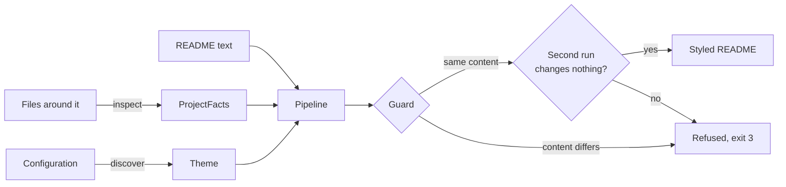

# Architecture

readme-style is a Cargo workspace with four crates:

| Crate | Path | Role |
|-------|------|------|
| `readme-style` | `/` (root) | The command-line tool: arguments, files, diffs, reports, exit codes, and `suggest` (the only network code). |
| `readme-style-core` | `crates/readme-style-core` | The engine: parsing, project inspection, themes, transforms, the guard. No terminal, no process. |
| `readme-style-wasm` | `crates/readme-style-wasm` | The engine compiled to WebAssembly for the browser playground (`playground/`). Never published. |
| `xtask` | `xtask` | Development tasks (corpus, gallery, playground, debugging, screenshots). Never published. |

The engine does not read files on its own: project inspection goes through the `FileSystem` trait
(`OsFs` for the disk, `MemoryFs` for tests and for hosts without one), and styling is a pure
function from text to text.

## Data flow

1. **Inspect** (`project`): manifests (`pyproject.toml`, `package.json`, `Cargo.toml`, `go.mod`),
   the license file, GitHub workflows, tool configuration, `.git/config` and logo files become
   `ProjectFacts`. Every fact keeps its evidence, which `--explain` prints.
2. **Configure** (`config`, `theme`): the configuration is found by walking up from the README to
   the repository root. Themes are TOML tables merged in order: `base.toml`, the theme's `extends`
   chain, the theme, then the configuration's overrides. The result is checked against the `Theme`
   struct, which rejects unknown keys.
3. **Style** (`engine`): the pipeline runs, then the guard compares the result with the input, then
   the pipeline runs again on its own output and must change nothing.

## The document model

`Document::parse` (in `document.rs`) parses with comrak, GitHub's parser ported to Rust, and keeps
an owned summary; the parse tree is dropped before it returns:

- **Lines**, the unit every edit works on.
- **Blocks**: the top-level blocks in source order, each with its line span, kind, text content,
  links and images. Text is read from the tree, where reference links are already resolved; raw
  HTML (blocks and inline tags) is tokenized, so `<a href>` and `` count like their Markdown
  forms.
- **Headings** with GitHub's anchors (the github-slugger algorithm, counting every heading so
  repeated titles get `-1`, `-2`).
- **Regions and wrapper lines**: what readme-style manages (see below).

`Outline` (in `outline.rs`) reads the structure a person sees: the title (an H1, an HTML `<h1>`, or
an opening heading nothing outranks), the tagline, the hero (logos, title, tagline, badge rows),
sections, and whether the README already has badges, a table of contents or a nav row. It only
looks at user content, so a styled README has the same outline as the original.

## Markers: the README is the state

Everything readme-style writes is delimited by HTML comments, so there is no cache and no
side file:

- A **region** is generated content between `<!-- readme-style:NAME theme=THEME -->` and
  `<!-- /readme-style:NAME -->`. It is rewritten on every run and always placed where the theme
  says; a region the user moved is put back. Names in use: `logo`, `header`, `toc`, `back-to-top`.
- A **wrapper line** is one generated line ending in a marker, such as
  `
<!-- readme-style:center -->`. Wrappers (`center`, `collapse`) wrap user
  content without touching it. They are all removed first and rebuilt last.

Markers inside code blocks are ignored, so a README can document them. Regions do not nest: a new
start marker closes any open one, and a marker that is never closed is reported and treated as text.

## The pipeline

Transforms are functions from a parsed `Document` to new lines (or nothing). The engine re-parses
only after a step changed the text. The order is part of the design:

| Step | Does | Why here |
|------|------|----------|
| `strip-wrappers` | Removes wrapper lines | Later steps see the README as the user wrote it. |
| `callouts` | `**Note:**` lead-ins become GitHub alerts | Upgrades user content before anything is placed around it. |
| `logo-variants` | Gives an existing logo a dark-mode `<picture>` | Same. |
| `header` | Syncs the `logo` and `header` regions (tagline, badges, nav, divider) | Regions move to their final place before sections fold, so a region left by another theme never decides whether a section folds. |
| `toc` | Syncs the `toc` region before the first section | Same. |
| `collapse` | Folds long changelog, news or FAQ sections into `
` | Needs regions in place; back-to-top links are placed after it. |
| `back-to-top` | Syncs one `back-to-top` region after each long section | Must land after a folded section's closing line. |
| `center` | Wraps the hero in a centered div | Needs the final logo, title and header positions. |

Edits are line operations (`edit.rs`) applied bottom-up. Inserted blocks are kept one blank line
from their neighbours. Deleting generated lines keeps the structure around them: blocks that were
apart stay apart, a block that swallowed the lines stays whole (raw HTML without a blank line after
it does that), and where a blank line would not separate (an indented line after a list or indented
code) an empty comment is left instead.

## The guard

`guard.rs` is deliberately independent of the transforms. It strips managed lines from both
versions (each run of them becomes an empty comment, which separates blocks exactly as the markers
did), renders both with GitHub's options, tokenizes the HTML and compares atoms: words, exact code,
link targets, image sources with alt text, heading levels, line breaks and block boundaries. A
GitHub alert's title stands in for the lead-in it replaced; emoji are not words. On a mismatch it
reports the first difference with its line in the original.

## Testing

| Layer | Where | What it proves |
|-------|-------|----------------|
| Unit tests | next to the code | Each module's behavior, including slugs, markers, editing and inspection. |
| Transform tests | `crates/readme-style-core/tests/transforms.rs` | Each feature, through the public API. |
| Guarantee tests | `crates/readme-style-core/tests/guarantees.rs` | Idempotency, theme switching, line endings; property tests over generated READMEs, well-formed (never refused) and adversarial (never a crash, never unstable output). |
| Gallery | `examples/`, `crates/readme-style-core/tests/examples.rs` | Snapshots of every theme on four projects. |
| CLI tests | `tests/cli.rs` | The binary: modes, exit codes, configuration, JSON, CRLF. |
| Corpus | `cargo xtask corpus` | About 200 popular READMEs, every theme, every theme switch: no refusals, no instability, no drift. |

## Performance

Styling a typical README takes 3 to 10 ms in a release build, including the guard and the second
run; the largest README in the corpus (2,700 lines) takes about 110 ms. Parsing dominates, so the
engine parses once per change rather than once per step, and reads text from the tree instead of
rendering and tokenizing every block. `cargo run --release -p readme-style-core --example profile --
README.md` times each stage. The WebAssembly build is about as fast in Chrome: 15 ms for an example
project, 75 to 110 ms for the largest corpus README, so the playground can restyle as you type.

## The playground

`cargo xtask playground` builds a static site in `target/playground`: the page in `playground/`, the
examples, and `crates/readme-style-wasm` compiled to WebAssembly (the `wasm` profile, optimized for
size: about 3 MB, 0.9 MB compressed). The module has no imports and no glue library. JavaScript writes
a JSON request into a buffer the module hands out, calls `style`, `render` or `themes`, and reads the
JSON answer back; the only `unsafe` is the `no_mangle` that exports those functions.

A request carries the README and, optionally, the project's files. They are served to the engine
through `MemoryFs`, so configuration discovery, theme choice and project inspection are the same code
as on the command line, and a folder opened in the browser gets the badges it would get there. Nothing
is uploaded.

The preview first reduces the rendered HTML to what GitHub keeps (`playground/sanitize.js`, an
allowlist modelled on GitHub's: no scripts, styles, forms, `meta`, `base`, SVG, image maps or
templates, and only `http`, `https`, `mailto` and relative links). It then shows it in a frame with
`sandbox="allow-scripts"` (an opaque origin) and a content security policy that lets only the
frame's own script run, by nonce, with `base-uri` and `form-action` set to `'none'`. That script
scrolls to anchors and passes other links to the page, tagged with a token only that document
knows; the page ignores any other message, and replaces the frame's content if anything navigates
it away. `playground/tests/smoke.py` checks all of this in headless Chrome.

## Suggestions

`readme-style suggest` (in `src/suggest/`) is deliberately outside the engine. It builds a prompt
from the README, the project facts and, for diagrams, a two-level file listing; sends it to Anthropic's
Messages API or an OpenAI-compatible server (plain HTTP with `ureq`, retries on 408, 409, 429 and
5xx); checks why the answer stopped (a refusal or a truncation is an error, never a suggestion); and
prints what it parsed. It never writes, so the guarantees above are untouched: a pasted suggestion is
user content like any other. `tests/suggest.rs` runs it against a local mock server.
